# 相機＋IMU 在 LiDAR 地圖上的線上定位

只用三台魚眼相機、IMU（Track01/02 另有 GNSS），在預建的 LiDAR 點雲地圖上，**逐幀、只往前**估計車輛的位置與航向。
不重建 3D 點雲、不做 NDT/ICP：把**相機看到的路面標線**直接對齊**地圖裡的標線**，再用一個因果的擴展卡爾曼濾波器（EKF）融合。

課程：自駕車（SDC）2026 期中專題 Midterm01（Kaggle 競賽，三個 track）。

| | 感測器 | Public | Private | 名次 |
|---|---|---|---|---|
| **Track03** | 相機＋IMU（**無 GNSS**） | 0.199 | **0.247** | **Private 第 1**（第 2 名 0.561） |
| Track02 | 相機＋IMU＋GNSS | 0.250 | 0.250 | `[待補]` |
| Track01 | 相機＋IMU＋GNSS | 0.459 | 0.459 | `[待補]` |

分數 = 位置 RMSE（m）＋ 0.2 × 航向 RMSE（度），越低越好。T1/T2 的 public 就是整條軌跡；T3 的 public 只算前約 13%，private 算其餘約 87%。

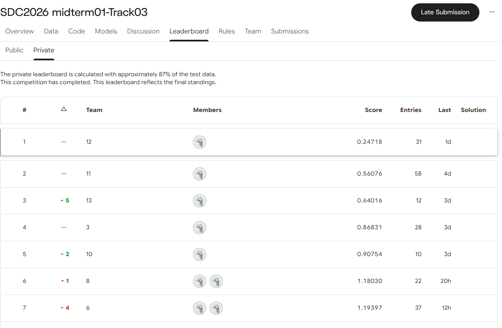

<!-- TODO: docs/img/kaggle_t1_private.png, docs/img/kaggle_t2_private.png -->

**影片**
- Track03 全程（下：10 m 圓柱全景＋地圖標線紅點；上：鳥瞰圖，白＝相機標線、紅＝地圖標線）：https://youtu.be/lOZ3_UJ-BtI
- 剎車點頭補償前後對照（第 780–960 幀）：https://youtu.be/igVFbaVIgVg

---

## 1. 問題

- **輸入**：三台魚眼相機（左前、前、右前，各約 125° 水平視角）、IMU、LiDAR 地圖 `map.pcd`、起點粗略位姿 `init_guess.txt`；Track01/02 另有 GNSS。
- **輸出**：每一幀的 `x, y, yaw`。
- **規則**：線上（因果）定位，第 k 幀只能用第 1…k 幀的資料，寫出後不能修改；禁止 RTS 等雙向平滑與定位後的離線修正；禁止用 leaderboard 分數反推軌跡；助教會重跑程式。

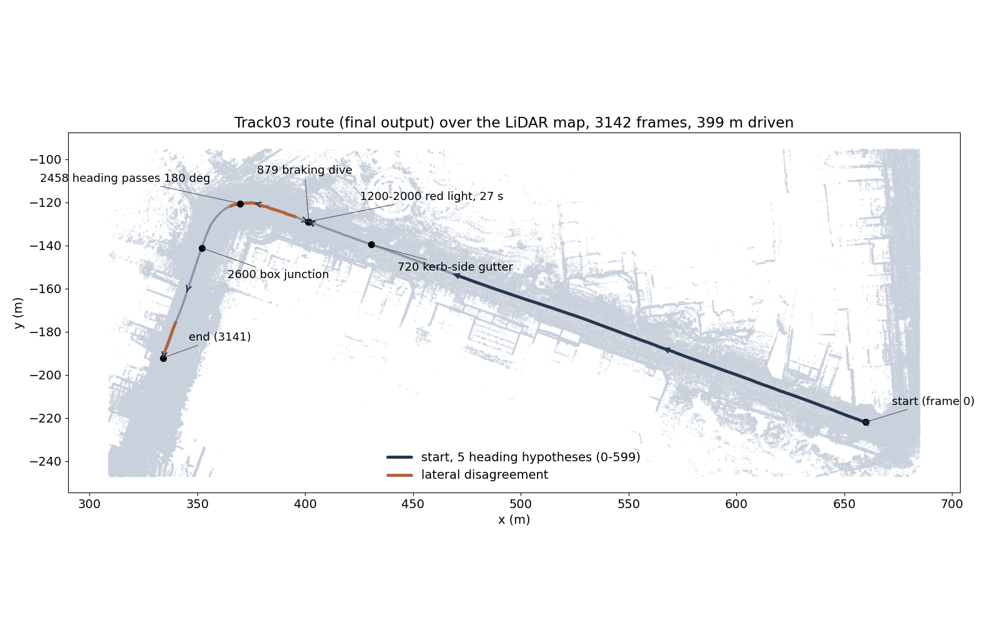

Track03 沒有 GNSS、起點航向偏約 17°、一開始就在行駛，中途停紅燈 27 秒，路面有坡度、排水坡，是三軌中最難的一軌。

## 2. 方法概覽

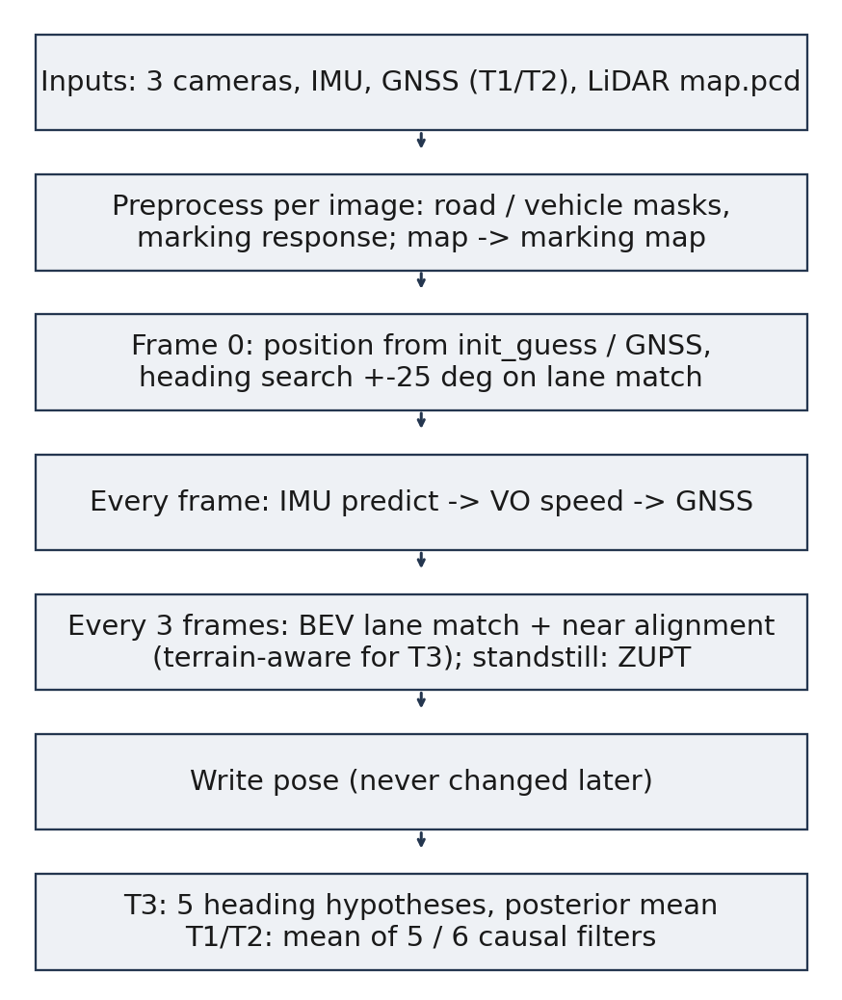

大多數做法是「相機 → 點雲（MapAnything 等）→ NDT/ICP 對地圖」。本專案反過來：**地圖不變成影像、影像也不變成點雲**，而是把兩邊都變成「路面標線的俯視圖」，用相關搜尋對齊。理由見第 4 節：模型推估的點雲每幀尺度與形狀都不穩定，連位姿已知的幀都對不準。

## 3. 原理

### 3.1 相機配置

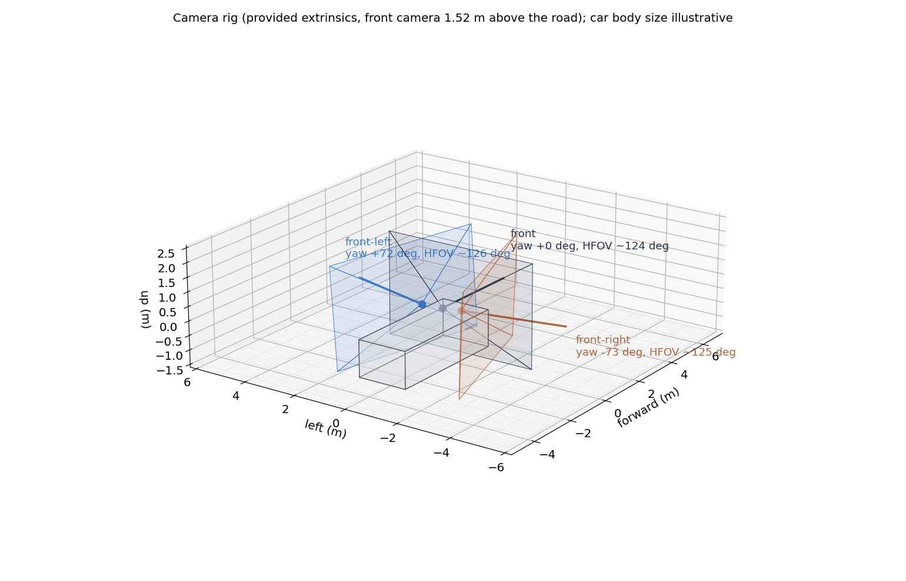

助教只提供三台相機**彼此之間**的外參（以前相機為基準），沒有相機離地高度或到車體中心的關係。
- 相機高度 1.52 m、各相機零點幾度的旋轉修正：自製標點工具（影像標線 ↔ 地圖標線，41 對，每幀位姿一併求解），再用「讓標線比對峰值最高」的自動搜尋交叉驗證。
- 內參沿用提供的魚眼模型（`cv2.fisheye`）。
- 輸出參考點是前相機。

### 3.2 地圖端：從 LiDAR 找出地面與標線

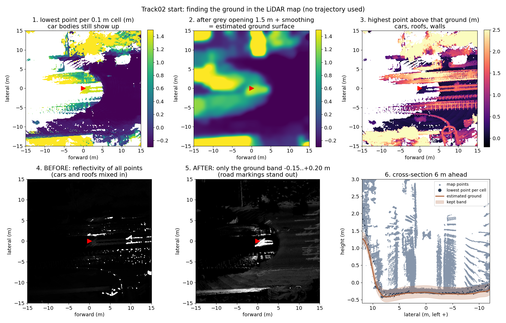

1. 每 0.1 m 格取最低點 → 灰階**開運算**（1.5 m）削掉車、柱子等凸起 → 平滑，得到地面高度。
2. 只保留貼地 −0.15～+0.20 m 的點：車身、車頂自然排除，不需要任何軌跡。
3. 標線漆反光強：每格取反射強度中位數、減去 1.5 m 背景、除以局部雜訊，雙門檻（2.5 / 1.2 倍）得到標線地圖。

（圖中 T2 起點排隊的車連成一片、比 1.5 m 寬，地面被墊高，是這個方法的已知弱點，見第 6 節。）

### 3.3 影像端：哪些像素可以用、哪裡是標線

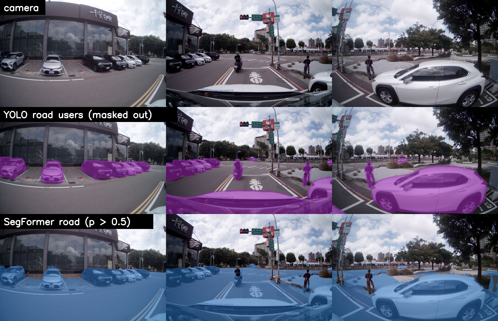

- **YOLO**（紫）遮掉車、機車、行人；**SegFormer**（藍）找出路面。SegFormer 會把路上的車也算進路面，所以兩個都要。
- 標線：在鳥瞰圖上做**白色 top-hat**（原圖 − 開運算，0.7 m 窗口），挑出「比周圍亮、又比 0.7 m 窄」的東西，再除以局部標準差做對比正規化。
- 三台相機**各自**算響應後才合併（重疊取平均），避免曝光差異在交界處產生假邊緣。

### 3.4 投影到鳥瞰圖：地面不一定是平的

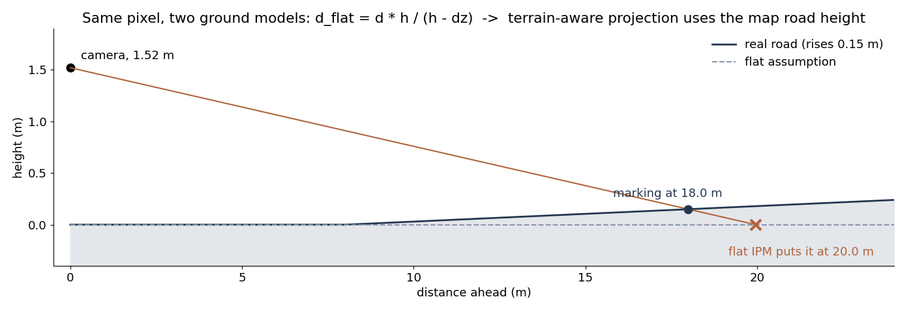

鳥瞰圖用**逆向映射**產生：每個 0.1 m 格子有一個 3D 地面點，用外參＋內參投影回相機取像素。
- 平面假設下，前方 18 m 處高 0.15 m 的標線會被投到 20 m。
- Track03 改用**地形投影**：以預測位姿查地圖，車底 ±4 m × ±2 m 擬合平面，前方沿車道取縱向剖面（三次曲線），每格用實際路面高度投影。
- 再疊上車身姿態：剎車點頭 0.3°/(m/s²) × IMU 縱向加速度（過去 0.5 s）、IMU 快速俯仰（1.5 s 高通）、線上估計的固定側傾（IMU 側傾 − 地圖路面側傾，累積平均，T3 約 0.37°）。

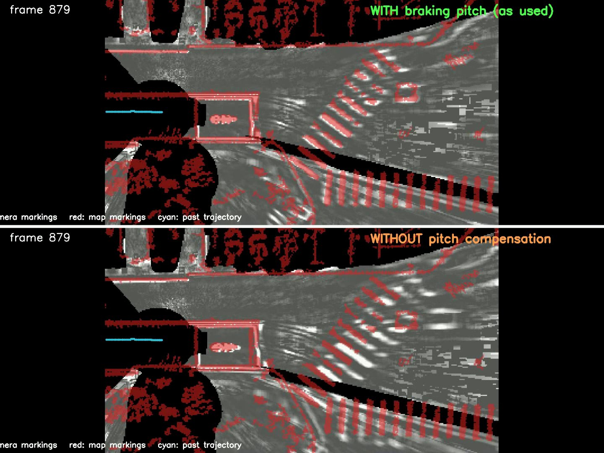

上：有補償，斑馬線白（相機）紅（地圖）重合；下：沒補償，相機前傾、標線被投得太遠。

### 3.5 相關搜尋：鳥瞰圖對地圖

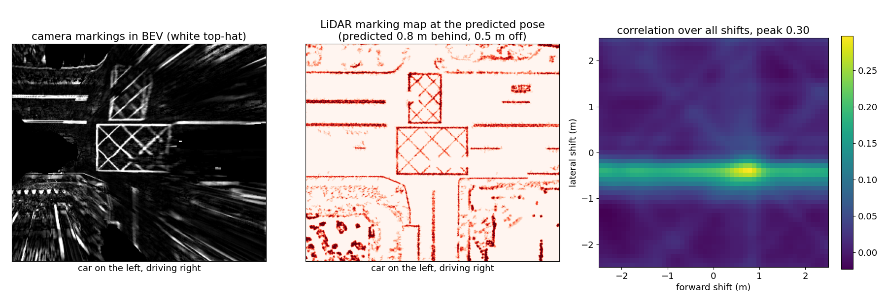

把相機標線圖在地圖標線圖上平移（前後、橫向各 ±2.5 m，步距 0.1 m）與旋轉（±3°，粗 0.5°、細 0.1°），每個位置算正規化相關，峰值就是修正量；再用拋物線內插取到次格精度。
上例故意讓預測位置偏 0.8 m，相關圖的峰值正好落在 +0.8 m。
- 峰值高低 → 這次比對可不可信（< 0.08 不用）。
- 峰的尖銳度 → 量測雜訊；前後、橫向分開看（沿長直線時只有橫向可靠）。
- 和 ICP 不同，不需要點對點對應，範圍內全部試過，峰的形狀直接給出不確定度。

另一個獨立量測「近距對齊」：把 0–14 m 內的地圖標線投回三台原始影像，搜尋橫向偏移。

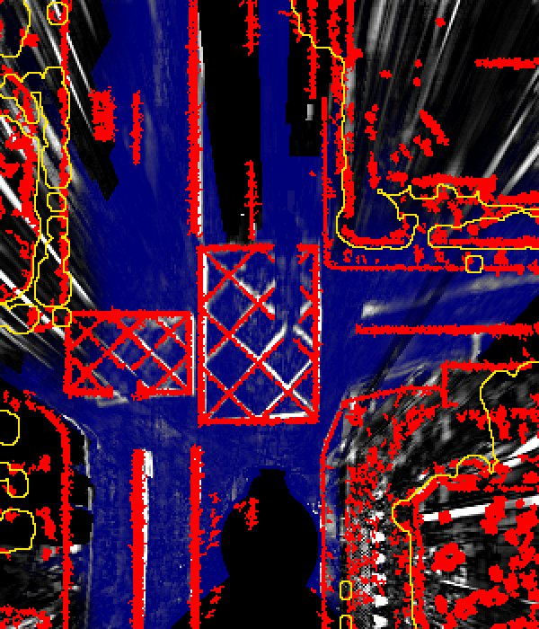 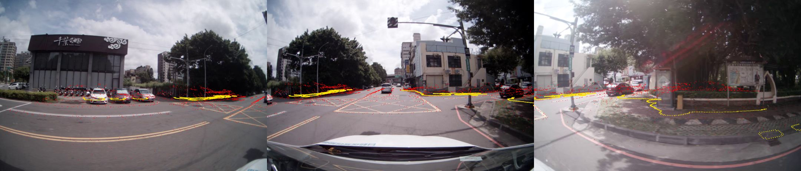

Track03 第 2600 幀：白＝相機標線、紅＝地圖標線、藍＝SegFormer 路面、黃＝路面邊界。

### 3.6 因果 EKF

- 狀態：x、y、航向、速度、加速度零偏、VO 比例、陀螺儀零偏。
- 每幀：IMU 預測（只用該幀時間以前的樣本）→ VO 速度（前相機路面相鄰兩幀比對）→ GNSS（T1/T2）→ 每 3 幀標線比對＋近距對齊（4σ 門檻、Huber 2.5）。
- **停車**：IMU 一秒內不變 → 速度設 0、更新陀螺儀零偏、不做地圖量測（同一張影像量上百次會讓位姿漂移）。
- **Track03 起點**：以第 0 幀航向搜尋為中心，同時跑 5 個航向假設（0、±1.5°、±3°），每幀輸出**後驗平均**（RMSE 下的最佳估計），第 600 幀保留最可能的一個。VO 比例初值 0.97（T1/T2 收斂值）。
- **Track01/02**：5～6 個設定略不同的因果濾波器逐幀平均；成員條件事先固定（近距橫向殘差不比基準差超過 0.005 m）。

## 4. 結果與比較

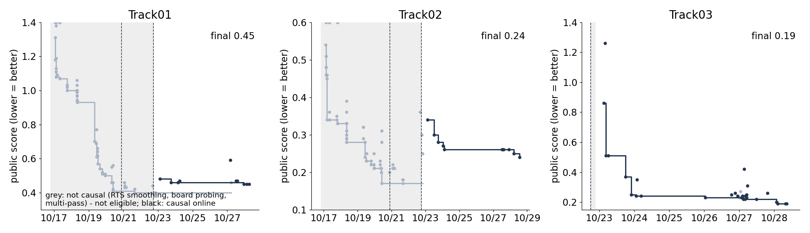

淺色：10/22 規則公布前的非因果做法（RTS 平滑、leaderboard 反推），已全部捨棄；深色：最終的線上流程。

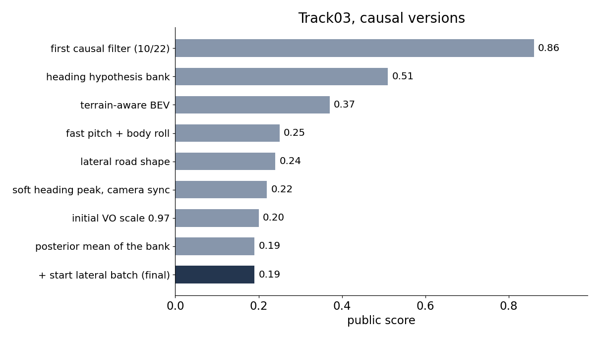

| Track03 版本 | 改動 | public | private |
|---|---|---|---|
| 第一版 | 因果 EKF | 0.863 | 1.410 |
| bank | 5 個航向假設 | 0.518 | 1.210 |
| tp | 地形投影 | 0.371 | 0.316 |
| tpr | 快速俯仰＋固定側傾 | 0.254 | **0.223** |
| tpl | ＋路面橫向起伏 | 0.242 | 0.289 |
| kvo97 | VO 比例初值 0.97、VO 補洞 | 0.209 | 0.247 |
| **最終** | ＋5 假設後驗平均、起步橫向批次 | **0.199** | **0.247** |

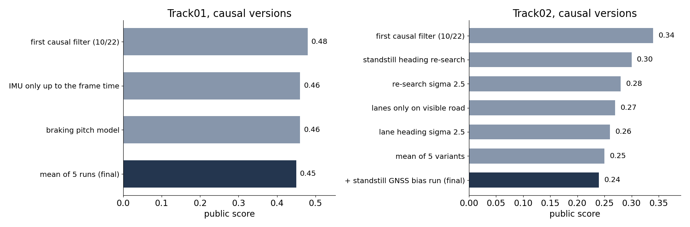
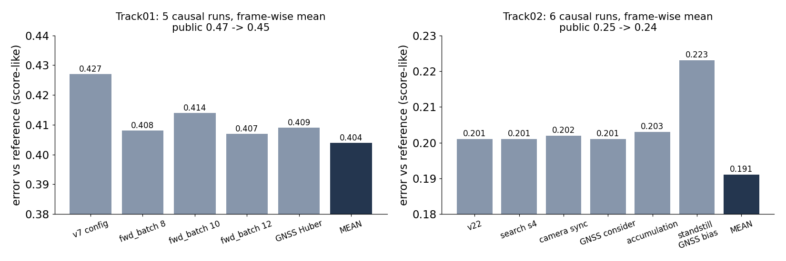

（右圖的參考是 10/21 的離線平滑軌跡，只用於內部比較，不進入任何提交。）

## 5. 試過但捨棄的

**MapAnything 點雲＋ICP**（T1/T2 有 `3cameras_ply`）

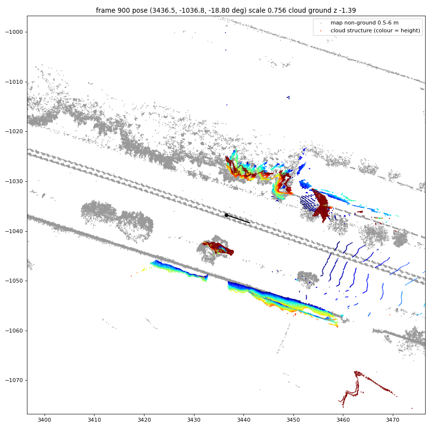
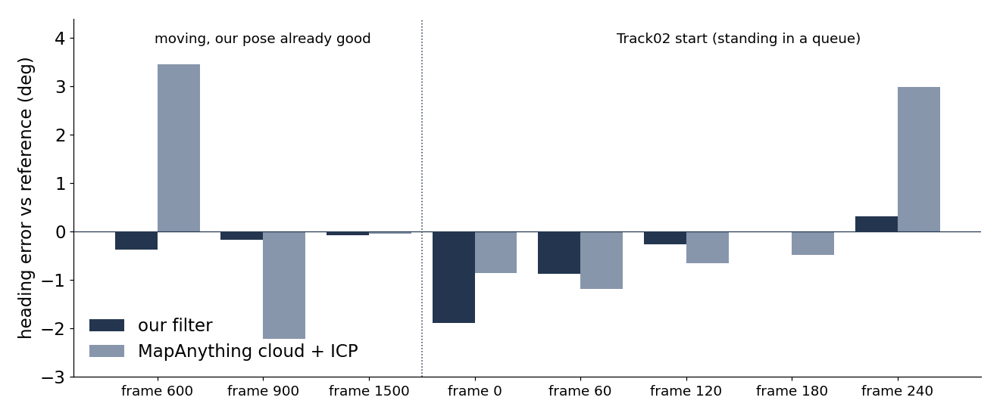

三輪實驗：尺度每幀 0.63–0.97 跳動、ICP 不收斂；尺度與航向/位置耦合（相機高 1.65 m → 位置橫移 2 m，1.45 m → 航向偏 1°）；用校正的 1.52 m 在**位姿已知很準**的幀驗證，航向仍錯 2–3.5°（濾波器 0.1–0.4°）。點雲本身每幀約 1–1.6° 扭曲，換配準演算法也救不回來，所以完全不使用。
`raw_ply`（LoGeR）每幀只涵蓋前方約 2 m、沒有尺度，同樣不用。

**規則改變前的做法**（保留在 `legacy/` 作紀錄）：RTS 雙向平滑、用 leaderboard 分數解最佳修正、沿軌跡修地圖。改成因果後 T2 從 0.17 退到 0.34，再做回 0.25。

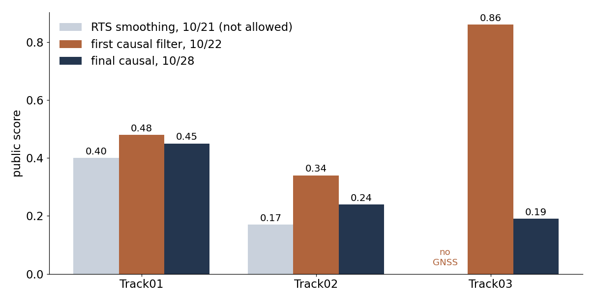

**地圖本身的問題**：Track01 起點測繪車停留造成高度漂移，整條路上方還有一層車頂點；最終不修地圖，T1/T2 改用平面投影避開。

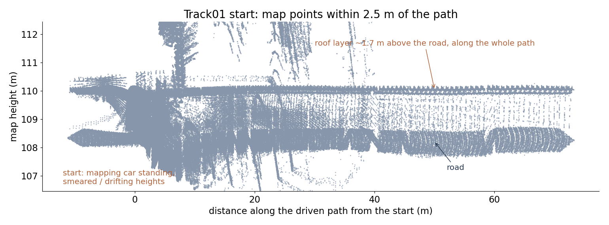

其他：桿子比對、近距對齊的航向（擾動測試只修回約 10%）、更多航向假設、VO 判斷停車、更多平均成員等，見 [`docs/DEVLOG.md`](midterm01/src/localization/docs/DEVLOG.md)。

## 6. 限制與心得

- **路面橫向起伏是兩面刃**：加上它，全段車道殘差 0.096 → 0.026 m、public 也小幅變好，private 卻從 0.223 變成 0.289。推測是用預測位姿查路邊高度，路緣附近高度變化劇烈，錯的地形把鳥瞰圖投歪、再把位姿拉偏，形成自我強化；地面估計在路邊本身也不準。**殘差變小只代表模型更自洽，不代表更準。**
- 可能的改進：找到修正後用新位姿重投影一次鳥瞰圖；橫向起伏只用在車道中央；用 T1/T2 關掉 GNSS 當 T3 的演練（唯一有真值的驗證）。
- Track01 標線稀疏處濾波器很敏感，只能靠多濾波器平均；Track02 起點停車時地圖本身轉了約 1°，因果條件下沒有正確的航向來源。

## 7. 執行

```bash
docker compose up -d --build            # ROS 2 Humble + CUDA；資料放在 data/Track{1,2,3}（Kaggle 下載內容）
docker exec -it sdc_midterm01 bash
cd /root/midterm/src/localization
bash tools/run_online.sh /root/data/Track3 T3      # T1、T2 同理 -> work/runs/<T>/<T>_online.csv
python3 tools/make_video.py /root/data/Track3 work/runs/T3/T3_online.csv work/runs/T3/mk_D.npz out.mp4 \
        --pano 10 --wide --bev_lat 10 --terrain    # 影片（如上）
```

需要 GPU 做分割（SegFormer-B2、YOLO11x-seg，首次執行自動下載），記憶體建議 ≥ 20 GB。
最終提交檔在 `midterm01/src/localization/submissions/final/`，可用上面的指令從零逐位元重現（環境細節見 DEVLOG 第 2 節）。

```text
midterm01/src/localization/
  tools/run_online.sh          完整流程（地圖 → 分割 → 標線地圖 → VO → 線上定位）
  tools/localize_online.py     因果 EKF、標線比對、近距對齊、航向假設
  tools/bev.py                 鳥瞰投影（平面／地形）、top-hat 標線響應
  tools/marking_map.py         LiDAR 地面與標線地圖
  tools/make_video.py          影片
  calib/                       相機外參修正、車身遮罩
  submissions/final/           最終提交檔
  docs/DEVLOG.md               完整開發紀錄（每個實驗、數據與失敗原因）
  legacy/                      規則改變前的程式（不屬於最終流程）
docs/img/                      本 README 的圖
```
